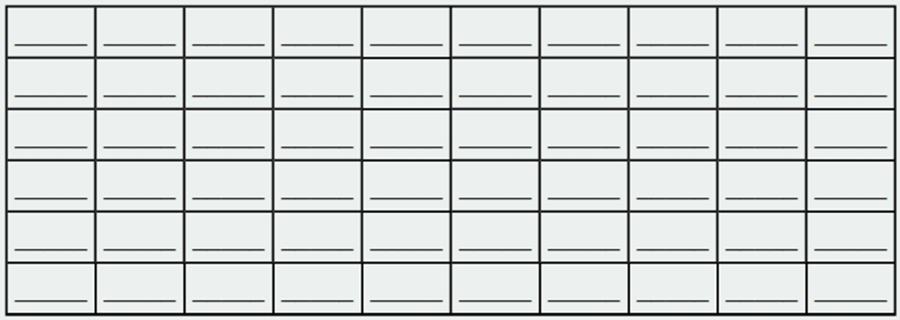

Задание 1. Первичная обработка данных (7 баллов)

1) Проведите сбор данных по выбранной проблеме. Объем выборки должен быть не менее 60 элементов.

2) Запишите собранные данные в таблицу в виде вариационного ранжированного ряда:
. 
Данные дискретны или непрерывны? Обоснуйте.

3) Выполните первичную обработку данных:
        a) постройте частотный или интервальный ряд
        b) постройте гистограмму частот
        с) вычислите кумулятивные частоты
        d) постройте график кумуляты
