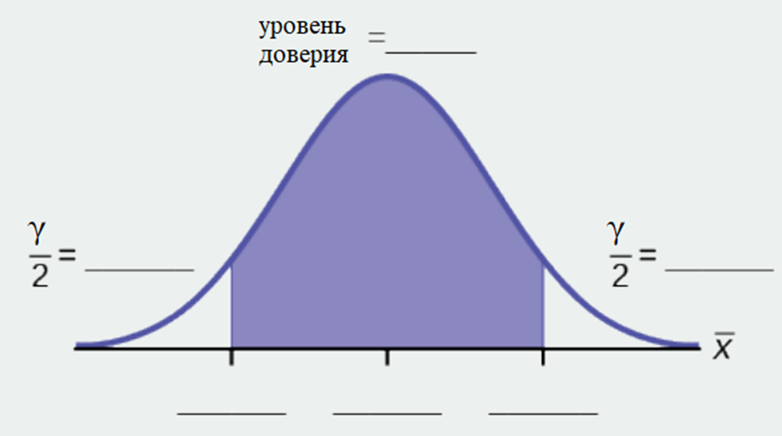

Задание 4. Построение доверительного интервала (9 баллов)

1) При заданном уровне доверии 0.9 рассчитайте:

	а. Доверительный интервал: _____          
	b. Граница ошибки: _____

2) Заполните пропуски на графике площадью в каждом разделе. Затем заполните числовую строку верхним и нижним пределами доверительного интервала и средним значением выборки

3) В одном-двух полных предложениях объясните, что означает этот доверительный интервал для данного конкретного исследования.