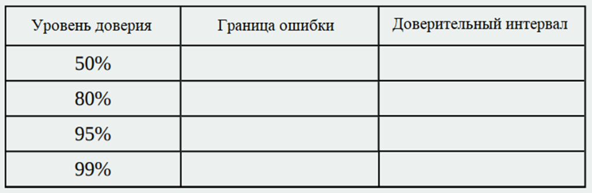

Задание 5. Анализ доверительного оценивания (6 баллов)

1) Постройте доверительный интервал для каждого заданного уровня доверия.

2) Что происходит с границей ошибки по мере увеличения уровня доверия? Увеличивается или уменьшается длина доверительного интервала? Объясните, почему это происходит.
